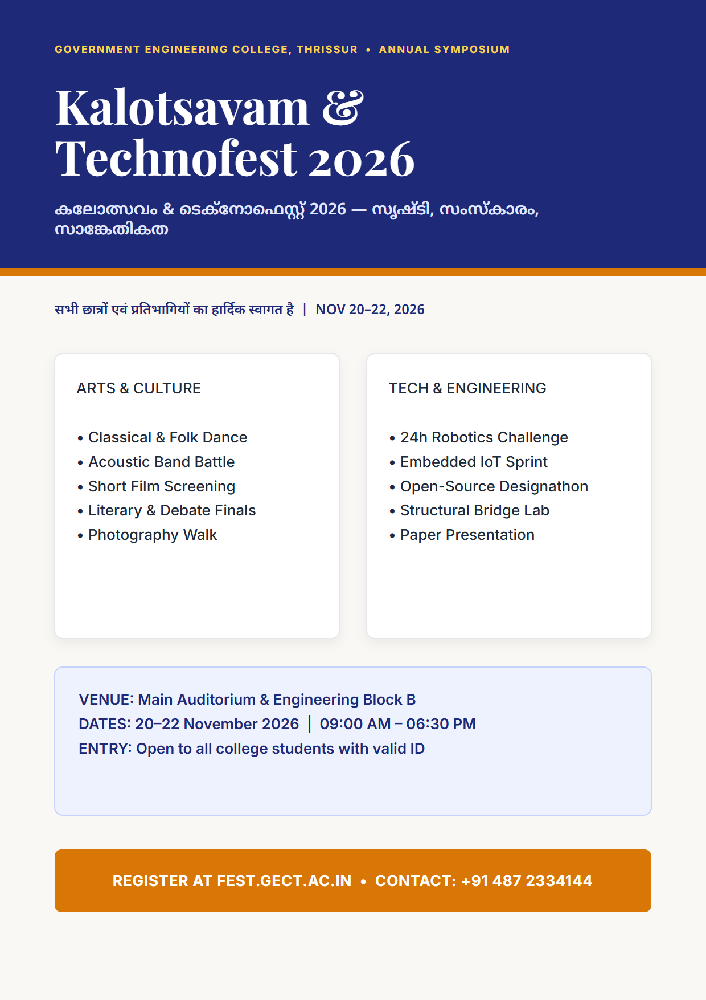
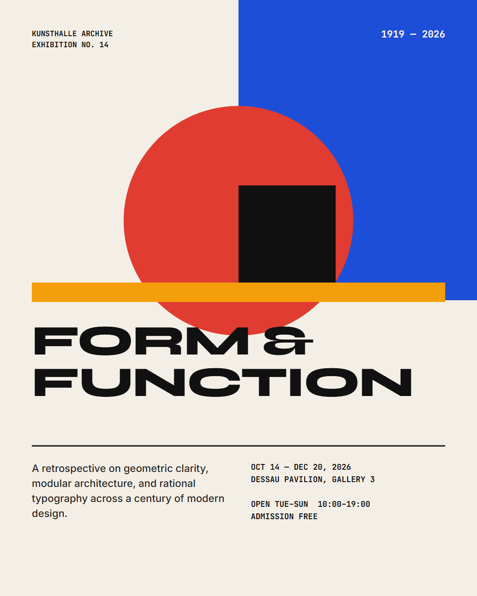
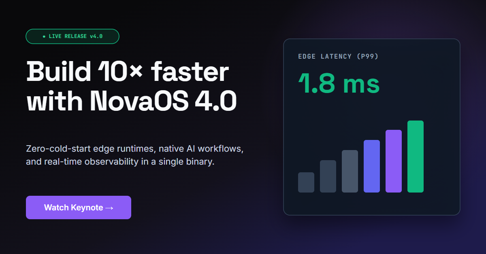
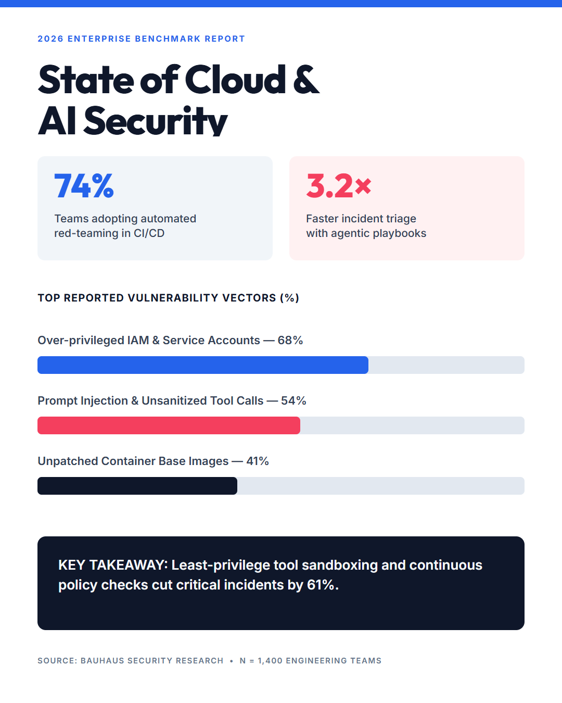

<p align="center">
  
</p>

<h1 align="center">Bauhaus (<code>bhs</code>)</h1>

<p align="center">
  Autonomous professional graphic design intelligence — an Agent Skills-compliant skill (invocable via <strong>Bauhaus</strong> or shorthand <code>bhs</code>) paired with a local-first editable design studio.
</p>

---

## Overview

**Bauhaus** turns an AI agent into a graphic designer and creative director that plans, constructs, visually inspects, critiques, and exports editable designs—never merely returning flattened images.

Every design is stored as a schema-validated `.bauhaus.json` scene graph and can be edited live in **Bauhaus Studio** (browser workspace) or controlled via CLI, HTTP/WebSocket API, and an MCP stdio server.

## Features

- **Agent Skills Compliant**: Validated against the official [Agent Skills specification](https://agentskills.io) (`skills-ref validate ./bauhaus`).
- **Live Editable Workspace (Bauhaus Studio)**:
  - Separate **Dashboard** (`/`) for browsing agent-created designs and **Design Editor** (`/design/<id>`) with `Layers` and `Projects` sidebars.
  - Interactive canvas with drag, 8-handle resize, rotation, inline text editing, alignment tools, color pickers, and 50-step Undo/Redo.
  - **Right-Click → Ask AI**: Copies a structured element reference (`[bauhaus:ref id="..." ...]`) to paste back into your AI agent for targeted edits.
  - **Upload & Decode**: Drop PNG, JPEG, WebP, SVG, or `.bauhaus.json` files to extract dimensions, aspect ratio, and dominant color palettes, or insert them as editable layers.
- **12 Editable Element Types**: `text`, `image`, `rect`, `ellipse`, `line`, `polygon`, `svg`, `icon`, `background`, `gradient`, `group`, `imported_asset`.
- **Multilingual Typography**: Automatic Unicode script detection for English, Malayalam (`Noto Sans Malayalam`), Hindi (`Noto Sans Devanagari`), Tamil, Arabic, and CJK rendered via Chromium's HarfBuzz engine.
- **Multi-Format Export & Verification**: Direct browser download and CLI/API export for `PNG`, `JPEG`, `WebP`, `SVG`, `PDF`, `Print PDF` (with bleed & crop marks), `HTML/CSS`, and `.bauhaus.json`.

## Quick Start

### Prerequisites

- **Node.js** `>= 20.0.0`
- **Google Chrome**, **Microsoft Edge**, or **Chromium** installed locally (used by `playwright-core` for rendering and PDF/PNG export)

### One-Prompt AI Setup (Copy & Paste)

Paste this prompt into **Antigravity**, **Claude Code**, **Cursor**, **Codex**, **Gemini CLI**, or **GitHub Copilot** to install and set up **Bauhaus** automatically:

```text
Install and configure the Bauhaus graphic design skill from this repository:
1. Install Node dependencies inside ./bauhaus (`npm install`).
2. Run `npm test` inside ./bauhaus to verify rendering, schema validation, and exports.
3. Validate the skill with `skills-ref validate ./bauhaus` (install `skills-ref` via pip if missing).
4. Link or copy ./bauhaus into my agent's skills directory (e.g. `.agents/skills/bauhaus` or `.claude/skills/bauhaus`).
5. Register the MCP server at `./bauhaus/scripts/bauhaus-mcp.mjs` if supported, and start Bauhaus Studio (`npm start` inside ./bauhaus) on http://127.0.0.1:4820.
```

### Manual Installation

```bash
git clone https://github.com/agnelfranciso/Bauhaus.git
cd Bauhaus/bauhaus
npm install
```

### Start Bauhaus Studio

```bash
npm start
```

Open **http://127.0.0.1:4820** in your browser.

### Run Tests & Skill Validation

```bash
# Run automated test suite (scene graph, security, multilingual, API, exports)
npm test

# Validate Agent Skills specification compliance
skills-ref validate ./bauhaus
```

## Supported Agents & Installation

**Bauhaus** follows the open [Agent Skills specification](https://agentskills.io) (`SKILL.md` + progressive disclosure) and includes a stdio MCP server (`bauhaus-mcp.mjs`), making it portable across compatible AI agents:

| Agent / Platform | Skill Discovery Path | Notes |
|---|---|---|
| **Antigravity** | `.agents/skills/bauhaus/` or `~/.gemini/config/skills/bauhaus/` | Native workspace & global discovery |
| **Claude Code** | `.claude/skills/bauhaus/` or `~/.claude/skills/bauhaus/` | Native `SKILL.md` progressive disclosure |
| **Cursor** | `.agents/skills/bauhaus/` or `.cursor/skills/bauhaus/` | Supports Agent Skills + MCP |
| **OpenAI Codex / Codex CLI** | `.agents/skills/bauhaus/` | Standard `SKILL.md` + CLI/MCP execution |
| **Gemini CLI** | `.agents/skills/bauhaus/` or `.gemini/skills/bauhaus/` | Compatible skill & MCP workflow |
| **GitHub Copilot** | `.github/skills/bauhaus/` or `.agents/skills/bauhaus/` | Agent Skills & MCP compatible |

To connect **Bauhaus** via **MCP** in any MCP-compatible host:

```json
{
  "mcpServers": {
    "bauhaus": {
      "command": "node",
      "args": ["/absolute/path/to/Bauhaus/bauhaus/scripts/bauhaus-mcp.mjs"]
    }
  }
}
```

## CLI & MCP Usage

```bash
# Validate a design document
node scripts/validate-design.mjs ./assets/examples/test1-cybersecurity-hackathon/design.bauhaus.json

# Render a visual-feedback PNG preview
node scripts/render-preview.mjs ./assets/examples/test1-cybersecurity-hackathon/design.bauhaus.json ./preview.png

# Export to PNG, JPEG, WebP, SVG, PDF, Print-PDF, HTML, or JSON
node scripts/export-design.mjs ./assets/examples/test1-cybersecurity-hackathon/design.bauhaus.json print-pdf ./flyer.pdf

# Start the stdio MCP server
npm run mcp
```

## Example Designs

| Cybersecurity Hackathon Poster | Social Media Promo | Multilingual College Flyer |
| :---: | :---: | :---: |
|  |  |  |

| Exhibition Poster | Keynote Launch Banner | Security Infographic |
| :---: | :---: | :---: |
|  |  |  |

## Repository Structure

```text
Bauhaus/
├── README.md
└── bauhaus/
    ├── SKILL.md                  # Agent Skills entrypoint
    ├── package.json
    ├── references/               # Design theory, critique, schema & integration docs
    ├── schemas/                  # JSON Schemas (design.schema.json, element.schema.json)
    ├── scripts/                  # Studio server, CLI, MCP server, renderer & exporter
    ├── studio/                   # Browser workspace UI, custom SVG icon pack & logo
    ├── assets/                   # Examples, templates & icon assets
    ├── projects/                 # Agent-created editable .bauhaus.json projects
    └── tests/                    # Automated test suite
```

## Known Limitations

- **Print-ready PDF**: Outputs sRGB vector/raster PDF with exact physical dimensions, bleed, and crop marks. True CMYK ICC offset color separation is not natively produced by Chromium PDF.
- **Stock Search & Image Generation**: Relies on user-supplied assets or external tools configured in the host agent environment.

## License

MIT
